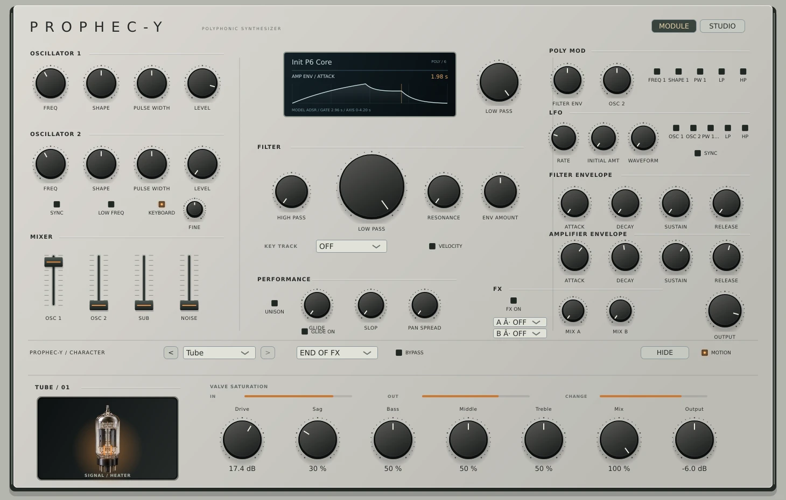

# v0.20 — Contextual display, first delivery

This adopts Vital's principle that a visual should explain the selected synthesis function. It uses our existing DSP laws and a native JUCE child component; no Vital code or graphics are reused.

| Selection | Implemented display | Scope |
|---|---|---|
| OSC 1/2 controls | Shape/PW nominal cycle | Active calibration/normalization, phase 0–1; before level, sync, modulation and anti-alias correction |
| Filter/amp envelope | Actual core ADSR simulation | Active A/D/S/R mapping; gate at A+D+0.25 s, labelled time axis; before depth, velocity and modulation |
| Incoming pitch bend | Existing live MIDI diagnostic | Raw14, bipolar position and mapped semitones |
| Other controls, including filter | Labelled position bar | No claim of acoustic response |

Clicking or keyboard-focusing a common hardware control selects it without changing its value. Automation of the focused control and changes to its related model parameters refresh the curve. Model work is cached by inputs and never touches live audio voices. The envelope preview uses an isolated 8 kHz core envelope, a bounded frame budget and stage-transition samples. Truncation is explicitly labelled.

## Native editor capture

## Validation

- 13 local CTest suites pass, including new contextual model tests.
- ADSR plotted samples match a separate 48 kHz core simulation within 0.003 normalized amplitude; stage times and fast attack peaks are checked.
- Oscillator preview matches the shared shape law and the real oscillator away from anti-alias corners.
- Native UI smoke captures oscillator, both envelopes and filter position; selecting/rendering these views leaves serialized plugin state unchanged.
- Existing deterministic DSP fingerprint is unchanged.
- CI additionally gates Windows/Linux builds, native smoke, pluginval and sanitizers before publishing a preview.

These are model previews, not hardware measurements or live per-voice telemetry. Filter response, LFO waveform/rate, FX diagnostics, output peak/RMS/clip and modulation range indicators remain open. Master Output, MIDI channel/monitor, browser and contextual Studio remain in the v0.20 plan.
