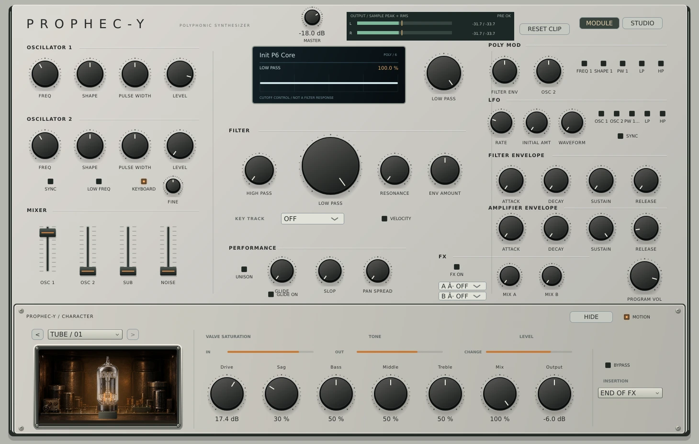

# v0.20 — Master Output and stereo output metering

A new final attenuation stage follows the complete synth, distortion, standard FX, Character insert and route gain. It is independent of canonical Prophet Program Volume (NRPN 62), which is now labelled PROGRAM VOL in Module.

## Behavior and compatibility

- Master Output is an appended host parameter `wrapper_master_output_db`, -60.0 to 0.0 dB in 0.1 dB steps, saved per plugin instance/session outside SysEx. New instances start at -18 dB.
- Existing v1/v2 wrapper sessions load at **0 dB**, preserving historical gain. The v0.17–v0.20 historical encoder fixtures remain unchanged and are tested with unity migration. Live changes use a 20 ms gain ramp; prepare initializes directly at the saved gain.
- State codec v3 appends a signed 0.1 dB value after the unchanged v2 fields. Truncated/invalid gain fields are rejected without modifying the caller state. Existing host parameter IDs/order are retained; Master is appended.
- Importing a Prophet SysEx retains the current Master, as it is global instance configuration. Export SysEx contains no Master or meter fields.
- No voice normalization, hard clipping or limiter was introduced. At 0 dB the stage is exactly unity. The core synthesis/FX fingerprints remain independent of this wrapper stage; fresh wrapper instances deliberately play 18 dB lower.

The hottest measured no-FX diagnostic peak (+16.91 dBFS) becomes -1.09 dBFS at the new default. This is useful measured headroom, not a guarantee for every patch/FX/feedback combination. Attenuation after FX cannot reverse distortion already produced inside a nonlinear effect. Listen and use the meters for gain staging.

## Meter contract

- L/R sample peaks retained between UI reads, plus 50 ms exponentially weighted RMS, measured **after** Master. Numbers show peak / RMS in dBFS; bars show RMS with a peak marker.
- Red CLIP flags latch independently at sample magnitude >= 1.0. RESET CLIP clears them.
- PRE warning latches if either channel reaches >= 1.0 **before Master**. The synth uses floating-point audio; this warning is a gain-staging diagnostic, not proof that internal hard clipping happened.
- Meter/clip data is transient and never saved. UI reads atomic telemetry; no UI access, allocation or locks are added to the audio path. UI refresh remains 30 Hz; stopped processing clears stale level displays after one second, while latched flags remain until reset.
- These are sample peaks, not oversampled true-peak or integrated loudness/LUFS measurements.

## Native editor

## Validation

14 CTest suites include unity output, -18 dB mapping of the measured hot peak, stereo clip flags, 20 ms ramp timing at 44.1/48/96/192 kHz, RMS amplitude and block partition invariance, state v3 persistence/rejection and legacy unity migration. Native smoke checks actual processor pre/post gain ratio, transient peak consumption, stored Master restoration, unchanged SysEx, numeric entry rejection, existing controls, audio and editor bounds. Full Windows/Linux, pluginval and sanitizer gates precede preview publication.

MIDI channel selection/monitor is the next block; it is not part of this output-stage delivery.
