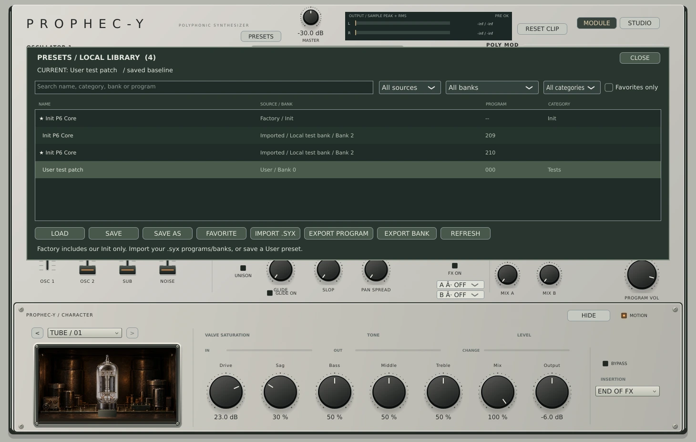

# v0.20 — Local preset browser

Open PRESETS in the Module/Studio header. The native overlay provides name/category/bank/program search, source, bank and category filters, favorites, explicit Load, Save, Save As, Import .syx, Export Program and Export Bank.

## Sources and editing

- **Factory:** our own Init P6 Core, plus the original 500 Sequential factory programs and 270 Old Men of MIDI programs. Collections use separate bank identities and keep their original names, addresses and SysEx data. Select Init and Load to initialize the musical patch, with the same unsaved-edit protection as other loads.
- **Imported:** Prophet-6 program/edit-buffer dumps or concatenated bank dumps. Import adds library entries without changing the active sound. Imported/Factory sound data is protected; Save opens Save As.
- **User:** Save As stores the current patch, four sequence controls and Character configuration. A library name/category and User bank 0–9/program 0–99 are separate metadata. The original Prophet payload and its hardware patch name remain intact. Save overwrites the active User entry; selecting a different row does not change what Save targets.

Selecting a row alone does not load it. Load, double-click or Enter loads it; edited patches show `*` in PRESETS, the current preset display and browser status. Loading another sound requires Discard and load or Cancel. Cancel leaves the sound untouched. Save/write failure does not acknowledge a clean baseline or discard current edits.

Master Output, oversampling, clock, calibration, Slop model and runtime wrapper controls are preserved when loading presets and excluded from the musical dirty signature. They remain DAW/session configuration. Character and raw patch/sequence edits count as musical changes. A save acknowledges exactly the captured snapshot, so edits arriving during disk I/O remain unsaved.

## Persistence and concurrency

Library records are versioned `.p6preset` JSON files in the per-user application-data folder under `Prophec-y/Presets/v1`. Each contains the musical state plus library metadata and, for imports, the original SysEx frame. Favorites survive reopening, including built-in program favorites. Back up this folder to preserve your library.

Writes use same-directory temporary replacement. A per-library interprocess lock serializes catalog mutations and scans; occupied User slots and stale overwrites from another instance are rejected. A malformed/unsupported record is skipped with a status warning. Full SysEx input validation precedes writing; failed imports roll back newly written records. This does not claim a whole-bank transaction across a process/power failure.

Closing/reopening the editor retains the active library association in the processor. A DAW project restores its complete sound as before, but the library ID/alias is currently transient: after a DAW reload use Save As unless you reselect/load an entry. No session-codec change or filesystem access was added to the audio callback.

## SysEx export contract

- **Export Program** exports the current Prophet patch, including current raw edits. Untouched imported frames are reused byte for byte. Library aliases/categories/favorites, Character and globals are not Prophet SysEx.
- **Export Bank** exports the **saved** entries in the selected row's bank, excluding active unsaved edits. Imported frame order and original bytes are retained even if the list is sorted by program number. User banks export in program order.
- A bank file is a concatenation of the programs actually present; missing slots are not synthesized. Edit-buffer collections retain edit-buffer framing rather than inventing addresses. Import rejects malformed, truncated, oversized (>16 MiB) dumps and duplicate addressed slots within one file.

## Native capture and validation

The capture uses synthetic test entries, not bundled factory sounds. Fifteen core suites include new transactional bank parsing and dirty-signature coverage. Native smoke checks disk save/reload, favorites, exact program/bank bytes and original order, User-slot collision, stale instance writes, failed save retaining dirty state/data, preserved global settings/Character, search filtering and bounds at three widths. Windows/Linux, pluginval and sanitizer gates remain required for preview publication. Native file-dialog and manual DAW workflows still need hands-on use.

MIDI channel selection/monitor remains postponed by the owner. Contextual Studio is the next main block. Compare/A-B, undo/redo, library-association persistence in DAW sessions and broader browser polish remain open; they are not claimed by this delivery.
