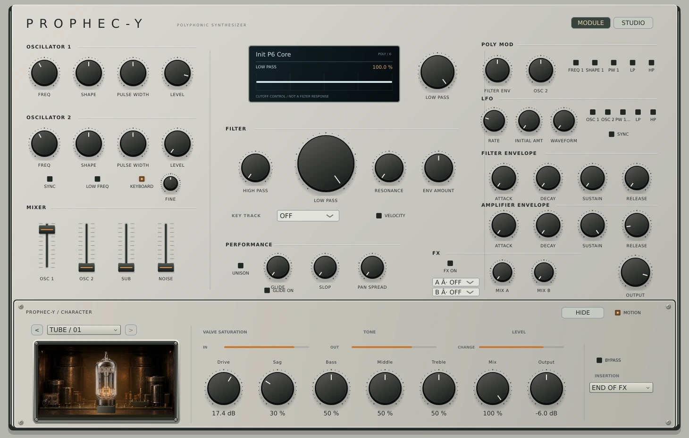

# v0.20 — Recessed Character device panel

The approved direction combines an independently mounted aluminum Character faceplate with an upright valve **inside a dark rectangular chassis cavity**. The valve stays behind the bezel, seated in its socket; it is not exposed above the panel or inside a blue capsule.

## Native implementation

- Separate lower faceplate with a perimeter seam, bevel, screw heads and subtle material difference from the synthesis panel.
- Extracted native `TubeChamber` component: embedded chamber background, separate transparent valve, socket occlusion, inset shadows and machined bezel.
- Chamber texture was generated specifically from the approved concept, with the center empty and no heater emission, then resized/encoded as an embedded JPEG. The valve is the existing embedded transparent PNG. Frames, shadows, socket lip and warm illumination are rendered by JUCE.
- Warm light follows existing measured input/change telemetry; bypass removes the light layers. Motion off retains the existing steady low illumination. No new audio or state parameters.
- Seven existing Tube controls remain editable, with IN/OUT/CHANGE meters. CHANGE is a latency-aligned waveform difference, not THD.
- Module selection, bypass, Start/End insertion, fold and motion controls remain available. Folding the bay leaves its header and audio active. None removes Character processing while retaining Tube settings.
- The upper synthesis surface and contextual OLED are preserved.

## Actual editor capture

## Verification

The native smoke checks existing state/SysEx preservation, live audio during automation, restored controls, bounds at 1240/1460/1780 widths, and that folding the new chamber preserves the complete plugin state. It captures active, bypass, None, Studio and a signal-driven series. The existing 13 core/presentation suites remain passing. Windows/Linux builds, native smoke, pluginval and sanitizers gate preview publication.

Manual DAW use and final visual review remain open. This change introduces the Tube presentation only; other Character effects are still future work.
